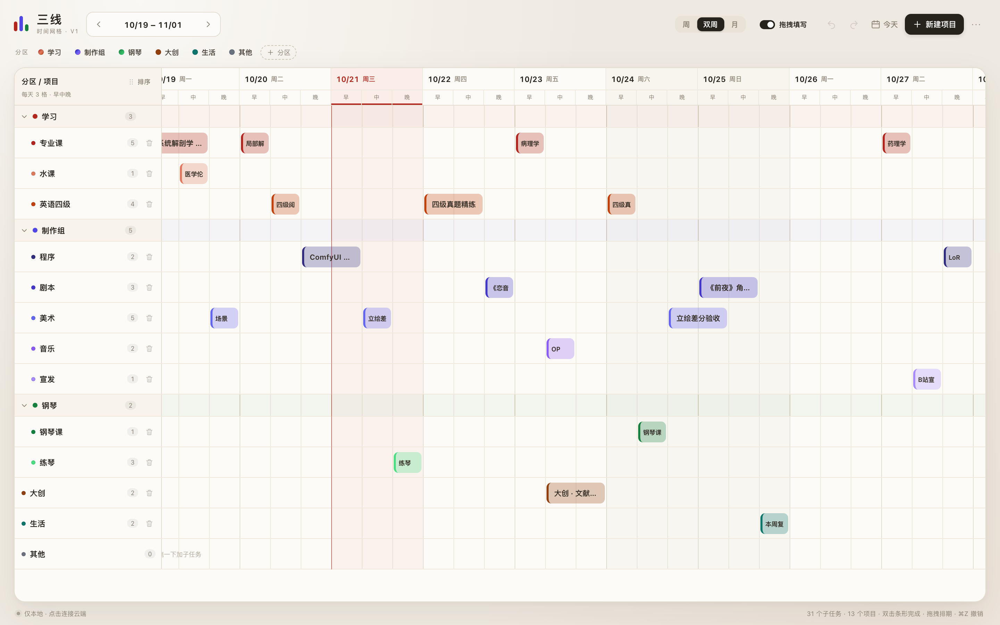
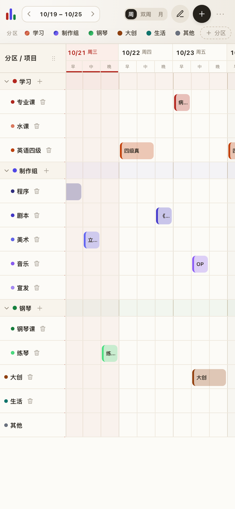
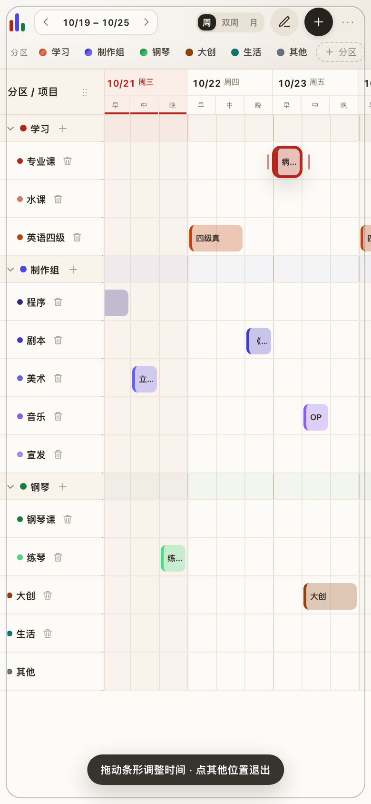
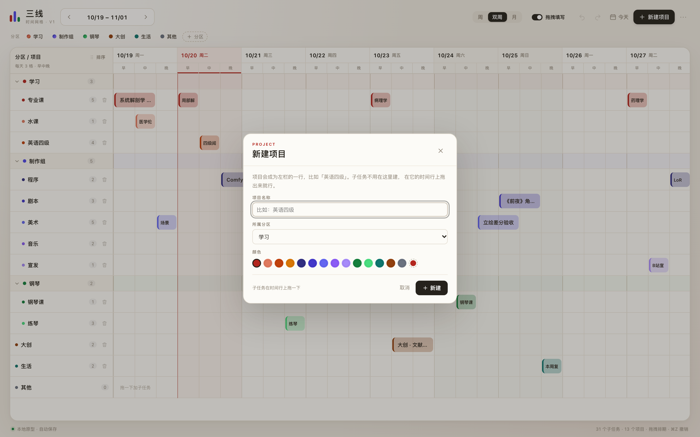
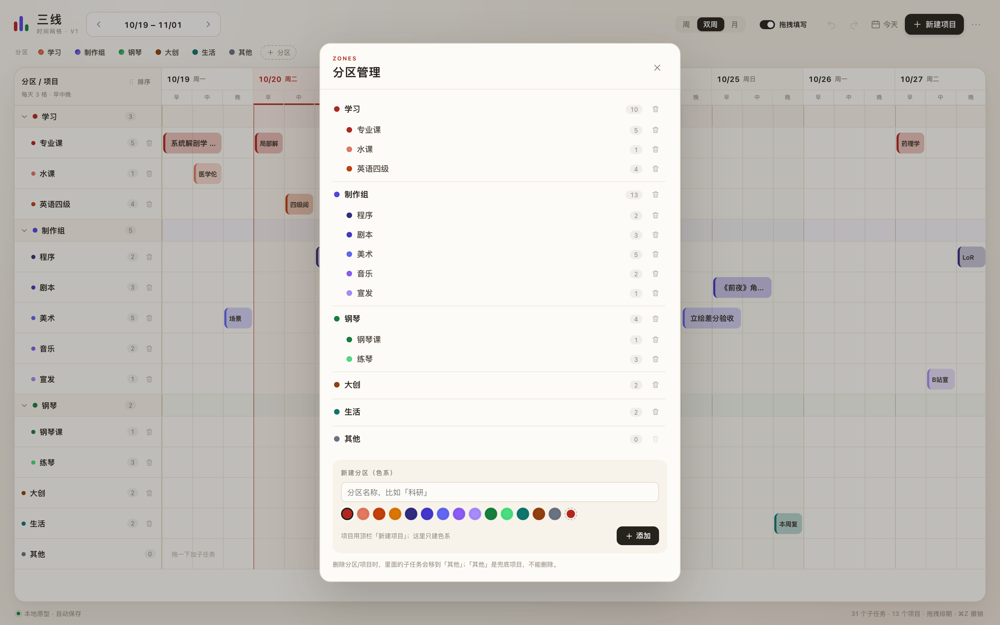
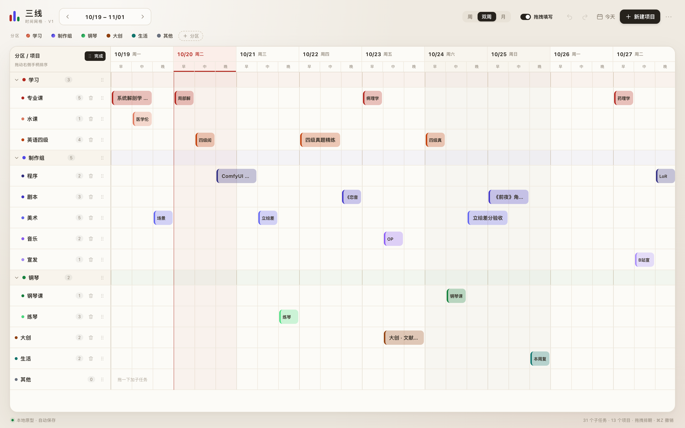
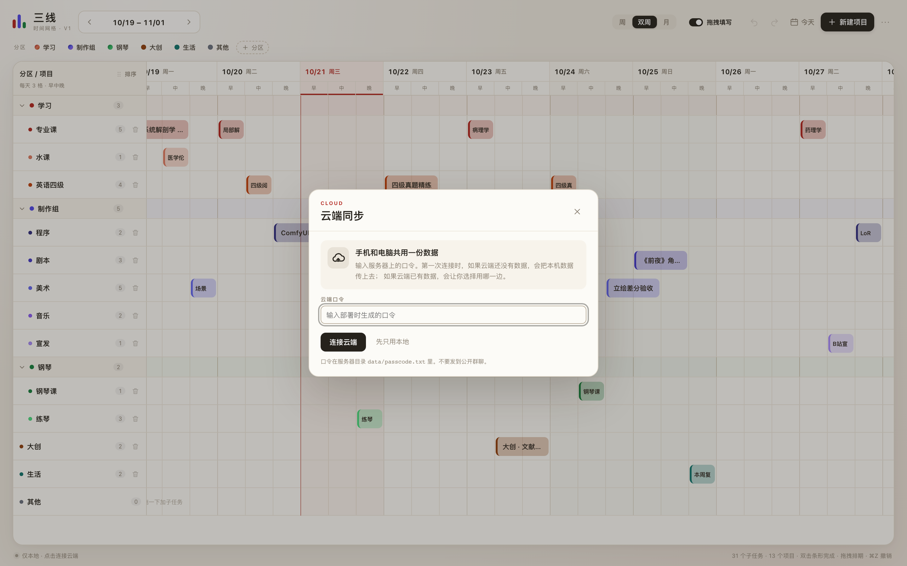

# 三线 · 时间网格 v1



老黑个人用的 **1/3 天甘特图**本地原型。目标不是做项目管理软件，而是把“学习 / 制作组 / 钢琴 / 大创 / 生活”放成一张可拖拽的时间网格。

当前版本是 **v1 + 多 workspace + 账号制 + PWA**：邀请制，一人一张独立的图；也可以用 Agent token 让 DSH 改任务。

> **2026-10 状态**：多 workspace / 账号制已部署到香港服务器，公网地址是 <https://sanchine.xyz>。旧 Mac 单用户版已停用，数据备份在 `data/backups/`。

<p></p>

## 左栏现在是「项目」，不是单个任务

- **分区（颜色家族）**：学习、制作组、钢琴、大创、生活、其他。
- **项目（左栏一行）**：专业课、水课、英语四级、程序、剧本、美术、音乐、宣发、钢琴课、练琴、大创、生活、其他。
- **子任务（项目行里的条形）**：比如「英语四级」项目下可以放「四级阅读精练」「四级真题精练」「四级真题一套」「四级听力精听」。

这样做的好处：左栏一眼看到的是“学科 / 板块”，不会被几十条具体任务撑爆；具体任务在时间轴上以条形出现，同一个项目下可以有很多条。

## 怎么用

- **新建项目**：顶栏右上角「+ 新建项目」，或者左侧分区标题右侧的「+」。
  - 填项目名（比如「英语六级」）、所属分区、颜色；新项目会出现在左栏对应分区下。
  - 新建项目只建一行，不会直接生成子任务。
- **新建子任务**：在项目行的时间区域上拖一段（手机是点一下）。
  - 「拖拽填写」开启 → 拖完弹出子任务详情，填标题、时间、备注。
  - 「拖拽填写」关闭 → 拖完直接生成子任务，默认用项目名（重名会自动加 2、3），不用起名字。
- **编辑子任务**：单击 / 点按时间条，改标题、项目、起止日期/早中晚、备注、完成状态；编辑器底部可以「删除子任务」。
- **双击标记完成**：桌面双击 / 手机双击条形，直接切换完成状态，不打开编辑器；再双击取消。单击编辑会有约 0.3 秒的判定延迟，用来区分单击和双击。
- **手机拖拽**：正常状态条形上左右滑 = 滚动时间轴，不会误移任务。**长按条形约 0.4 秒**进入拖动模式：界面锁定，只能拖这一条；左右拖移动时间，两端出现手柄，拖手柄改时长。**点条形以外的任意位置退出**。1 格宽的窄条也支持长按拖动和手柄改时长。
- **删除项目**：左栏项目名右侧的垃圾桶，会确认；项目里的子任务会**一起删除**，不会移到「其他」。删除后 toast 可撤销。
- **排序**：点左栏顶部「排序」，分区和项目右侧出现拖拽手柄；拖完点「完成」。顺序会保存。
- **隐藏分区**：点顶部图例里的分区名，名字划掉，整个分区从表格隐藏；再点恢复。
- **分区竖栏**：分区在最左侧窄栏竖排显示，不再占用表格整行；窄栏 hover 有新建项目和删除分区按钮。
- **改名**：双击（手机点一下）左侧分区名或项目名，原地改名。
- **时间范围**：左上角可直接选任意起始日；周 7 天、双周 14 天、月 30 天。
- **项目行高度**：只按当前视图内的并排子任务计算，并排任务移出视图后自动变矮。
- **分区管理**：点图例右侧「+ 分区」或顶栏「⋯ → 分区管理」。这里管理颜色家族、删除项目；新建项目走顶栏「新建项目」。
- **视图**：周 / 双周 / 月；今天按钮；上一段/下一段。
- **数据**：自动保存到 localStorage；菜单里可导出/导入 JSON（含分区、项目、子任务）、恢复示例、清空。
- **账号与同步**：登录后自动同步；点状态栏或「⋯ → 账户与同步」看状态、退出、生成 Agent token。断网先存本机，联网补传；两边都改过会弹「云端有更新」。
- **PWA**：菜单「安装到桌面」。iPhone 用 Safari 分享 → 添加到主屏幕；Android/桌面 Chrome/Edge 用安装入口。装完是全屏图标，断网还能打开缓存界面。
- **撤销/重做**：⌘Z / ⇧⌘Z；删除项目/子任务后 toast 里也能直接撤销。
- **键盘**：选中子任务后方向键移动，Shift + 方向键改结束时间，Delete 删除；完成状态也可以双击条形切换。

### 手机拖动模式



## 新建项目



## 分区管理 / 排序





## 账号、workspace 与 PWA



- **邀请制，一人一个 workspace**：朋友之间互相看不到对方的图。
- **首次启动**：服务器终端会输出 Setup token；打开网页，用 Setup token 创建管理员，现有 `state.json` 会导入到你的 workspace。
- **邀请朋友**：管理员在「账户与同步 → 邀请朋友」生成一次性链接；朋友打开后自己设置**登录名、显示名、密码**，就得到自己的空 workspace。
- **登录**：账号 + 密码；会话是 HttpOnly cookie，30 天。每台设备登录一次。
- **个人资料**：账户弹窗里可以改显示名、修改密码；管理员可以给朋友重置临时密码。
- **Agent token**：在「账户与同步」生成，只作用于当前 workspace；复制给 DSH 用，不要发公开聊天。
- **离线**：PWA 缓存界面，登录过的设备断网还能打开本地缓存；恢复后自动补传。
- **PWA 安装**：iPhone 用 Safari「分享 → 添加到主屏幕」；微信内置浏览器不能装。
- **数据位置**：新服务端用 SQLite `data/app.db`，按 workspace 隔离；旧单用户版仍是 `data/state.json`。

## 数据 schema（v1，已冻结）

- API/Agent 的快照格式固定为 `schemaVersion: 1`。
- 字段定义：`schema/gantt.schema.json`
- 运行时校验器：`schema/validate.mjs`（服务端和 CLI 共用）
- 人读说明：`schema/README.md`
- 当前线上数据已通过 v1 校验；具体数量用 `node agent/gantt.mjs state` 查看。

任务字段：`id / zoneId / title / startDate / startPart / endDate / endPart / done / note / order / createdAt / updatedAt`。  
分区字段：`id / name / parentId / color / order`。  
未知字段会被拒绝；以后加字段必须升到 `schemaVersion: 2`。

## Agent CLI

给 DSH / Codex 这类能跑命令的 Agent 用，不内置聊天框、不做公开 API。

```bash
cd gantt-v1
export GANTT_URL="https://你的公网地址"
export GANTT_TOKEN="gantt_..."   # 在「账户与同步 → Agent token」生成

# 也可以写进项目根目录 .env（已 gitignore），CLI 会自动加载：
# GANTT_URL=...
# GANTT_TOKEN=...

node agent/gantt.mjs state
node agent/gantt.mjs projects
node agent/gantt.mjs tasks --project 英语四级 --from 2026-10-20 --to 2026-10-27

node agent/gantt.mjs add-task --project 英语四级 --title "听力一套" \
  --start 2026-10-22/晚 --length 2

node agent/gantt.mjs move-task --id <id> --start 2026-10-24/中
node agent/gantt.mjs done --id <id>
node agent/gantt.mjs add-project --name 英语六级 --parent 学习 --color "#C2410C"
```

- 所有写操作先支持 `--dry-run`，再真正写入。
- 每次写入带 `baseRevision`；云端变了会返回 409，CLI 不会静默覆盖。
- `--json` 给 Agent 解析；`--yes` 用于删除确认。
- **不要直接改 `data/state.json`**，运行中的服务器会用内存状态覆盖它。
- 完整操作规则在 `AGENTS.md`。

每个 token 只能读写自己的 workspace；不同朋友的 token 互不通用。`.env` 会被 CLI 自动加载，DSH 不需要每次 export。

## 部署（当前）

- **腾讯云 Lighthouse 香港**，2核2G，Ubuntu 26.04。
- Node 26 + SQLite + systemd + Cloudflare Named Tunnel；服务器只出站，不需要开放入站 80/443。
- 公网入口：<https://sanchine.xyz>
- 数据：`/opt/sancine/data/app.db`，按 workspace 隔离；每日 SQLite 备份 cron。
- 旧 Mac 单用户版已停用，数据备份在 `data/backups/legacy-before-hk-日期.json`。
- 部署脚本和说明在 `deploy/README.md`。

> 入口是固定域名 `sanchine.xyz`，由 Cloudflare Named Tunnel 指向香港服务器；服务器重启不会改变地址。账号、workspace、数据都在服务器 SQLite 里。

## 启动（本地开发）

当前原型已经运行在：

- 本机：<http://localhost:5173/>
- 当前机器网络地址：<http://100.65.43.197:5173/>（Tailscale 地址，手机需在同一 Tailscale 网络）
- 公网试用：<https://sanchine.xyz>

重新启动开发服务器：

```bash
cd /Users/kulululu/Documents/deepseek-harness/default-workspace/gantt-v1
node node_modules/vite/bin/vite.js --host 0.0.0.0 --port 5173
```

也可以双击 `start.command`。

> 依赖已经装好。如果删了 `node_modules` 重新安装，`pnpm install` 若提示 `Ignored build scripts: esbuild`，运行 `pnpm approve-builds` 并允许 esbuild。

## 默认分区 → 项目 → 子任务

| 分区 | 项目 | 现有子任务示例 |
|---|---|---|
| 学习 | 专业课 | 系统解剖学、局部解剖学实验、病理学导论、药理学、生理学 |
| 学习 | 水课 | 医学伦理学 |
| 学习 | 英语四级 | 四级阅读精练、四级真题精练、四级真题一套、四级听力精听 |
| 制作组 | 程序 / 剧本 / 美术 / 音乐 / 宣发 | ComfyUI 工作流、恋音对白、立绘验收、OP 编曲、B 站宣发 |
| 钢琴 | 钢琴课 / 练琴 | 钢琴课、肖邦夜曲、巴赫、复习课 |
| 大创 | 大创 | 文献综述、问卷设计讨论 |
| 生活 | 生活 | 本周复盘、健身 |
| 其他 | 其他 | 兜底项目，删除其他项目时子任务会移到这里 |

内置的初始分区和示例数据在 `src/data.ts` 的 `DEFAULT_ZONES` / `createSampleTasks()`。日常增删项目直接用界面，不用改代码。

## 代码结构

```
src/
  App.tsx                 状态、历史、顶栏、图例、导入导出
  auth/
    AuthGate.tsx          登录态、Setup/Login/Invite 路由
    AuthScreens.tsx       登录 / 初始化 / 邀请页面
  components/
    Gantt.tsx             分区/项目行、子任务条形、拖拽、今天线
    TaskEditor.tsx        子任务编辑弹层/底部抽屉
    ProjectEditor.tsx     新建项目
    ZoneManager.tsx       分区（颜色家族）管理、删除项目
    AccountDialog.tsx     账户 / 同步 / Agent token / 邀请
    CloudConflictDialog.tsx 冲突时选用云端或本机
    InstallDialog.tsx     PWA 安装引导
    Icons.tsx             内联 SVG 图标
  sync/
    useCloudSync.ts       快照同步、离线补传、8 秒轮询、冲突处理
    cloudStatus.ts        同步状态文案

agent/
  gantt.mjs               Agent CLI（tasks/add/move/done/project/delete/export/validate）

schema/
  gantt.schema.json       冻结的 API 快照 schema v1
  validate.mjs            服务端 + CLI 共用校验器
  README.md               字段与不变量说明

AGENTS.md                 Agent 操作契约
  data.ts                 分区、颜色、示例子任务、排序
  date.ts                 日期 / 1/3 天 slot 计算
  types.ts                类型与视图常量
  styles.css              全部视觉样式

server/
  app.mjs                 多 workspace + 账号 + SQLite + Agent token + 静态托管
  server.mjs              旧单用户服务（已停用，保留参考）

public/
  manifest.webmanifest    PWA 清单
  sw.js                   开发占位；正式由 scripts/build-sw.mjs 生成到 dist/sw.js
  icons/                  192/512/apple-touch 图标

scripts/
  build-sw.mjs            构建后把带 hash 的 JS/CSS 预缓存进 sw.js
```

## 已知限制

- **域名已固定**：`https://sanchine.xyz` 由 Cloudflare Named Tunnel 提供；服务器可以换，入口不变。
- **同步不是实时**：8 秒轮询一次；不是协同编辑级别；一人一个 workspace，朋友之间不共享编辑。
- **账号是邀请制**：没有公开注册；忘记密码暂时需要管理员在服务器侧重置。
- **项目可以改名**：双击（手机点一下）左栏项目名即可。
- **手机拖动要长按**：这是为了避免和滚动打架；正常滑动仍然是滚时间轴。拖到屏幕外不会自动滚，先退出、滚动，再长按。
- **子任务删除不在左栏**：左栏是项目；点具体条形进编辑器删除，或选中后按 Delete。
- **没有重复任务**：每周固定课表/钢琴课目前要手动复制。
- **没有内置聊天 AI**：通过 Agent CLI 接 DSH / Codex；没有提醒、日历导出、依赖关系或多人协作。
- iOS PWA 的推送/后台能力弱；添加到主屏幕后仍建议把云端当主数据。

## 下一轮建议

1. 稳定部署：自动备份、监控、域名/隧道故障恢复。
2. 手机拖动的时间刻度提示 / 触感细化。
3. 每周固定课表（重复规则）。
4. 项目改名 / 归档。
5. 从 Excel/CSV 导入现有排期。
6. AI 自然语言录入与排期建议。

## License

MIT © 2026 [kulu-li](https://github.com/kulu-li)
